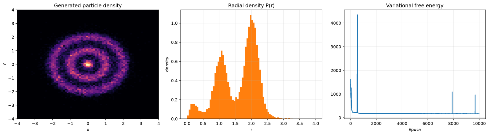
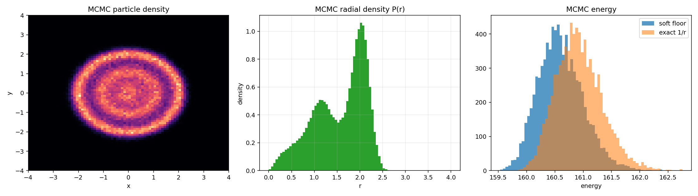
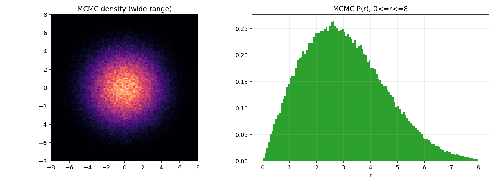

# 二维经典库仑气体：旋转等变与可逆 Normalizing Flow

本文记录最终在 AutoDL 上运行的经典模型：二维谐振子束缚下的库仑粒子体系，以及从标准高斯生成粒子坐标的旋转等变可逆 Normalizing Flow。

> 基础 v4 压缩包是 coupling 版本；AutoDL 后续加入了径向层、二维 log-det 修正和 x64 训练。本文描述最终实验架构。

## 1. 物理目标

有 N=20 个二维粒子，位置为 $X=(\mathbf{x}_1,\ldots,\mathbf{x}_N)$，其中 $\mathbf{x}_i\in\mathbb{R}^2$。

能量为

$$
E(X)=\sum_i\|\mathbf{x}_i\|^2+
\sum_{i<j}\frac{1}{\sqrt{\|\mathbf{x}_i-\mathbf{x}_j\|^2+\epsilon^2}}.
$$

其中 epsilon 是代码中的 distance_floor，用于缓解随机近碰撞造成的极端梯度。它也改变了势能和目标分布，并非仅仅是一个不影响物理结果的数值技巧；与 MCMC 公平比较时必须使用相同 epsilon。

目标经典分布为

$$
p_\beta(X)=Z_\beta^{-1}e^{-\beta E(X)},\qquad \beta=1/T.
$$

这里的温度是无量纲温度，默认 Boltzmann 常数和能量单位已经吸收到单位制中。低温实验使用 beta=10（T=0.1）；高温实验使用 beta=0.1（T=10）。此前对话称其为“10 K”并不严谨：若没有给出能量尺度，不能把无量纲 T=10 直接解释为物理上的 10 K。若代码能量以 E0 为单位，则物理逆温度为 beta=E0/(k_B*T_K)。

## 2. 总体结构

从标准高斯变量开始：

$$
z\sim\mathcal N(0,I),\qquad X=F_\theta(z).
$$

完整 flow 的数据流是：

    z: (N*2,)
      ↓ reshape
    x: (N, 2)
      ↓
    Coupling_0 → Radial_0
      ↓
    Coupling_1 → Radial_1
      ↓
    ...
      ↓
    Coupling_{L-1} → Radial_{L-1}
      ↓
    X: 20 个二维粒子

数学上：

$$
F=R_{L-1}\circ C_{L-1}\circ\cdots\circ R_0\circ C_0.
$$

Coupling 提供条件依赖的多粒子变换，Radial 提供直接的非线性半径变换。这是功能侧重点，不是严格分工：coupling 也能改变径向分布，径向层单独不能保证生成多壳层。

## 3. 高斯变量如何变成粒子坐标

训练循环先执行：

    z_batch = jax.random.normal(
        batch_key,
        (config.batch_size, config.n_particles * config.dim),
        dtype=dummy.dtype,
    )

典型情况下 z_batch 的形状是 (256, 40)。flow_apply 对单个样本执行：

    x = jnp.reshape(z, (config.n_particles, config.dim))

于是 x 的形状为 (20, 2)，x[i] 是第 i 个粒子当前的二维坐标向量。

## 4. RealNVP coupling 层

### 4.1 交替分组

当前代码用 even/odd mask：

    even = tuple(range(0, n_particles, 2))
    odd = tuple(range(1, n_particles, 2))

    if layer % 2 == 0:
        return even, odd
    return odd, even

第 0 层的 condition 是 0,2,4,...，target 是 1,3,5,...；下一层交换两组。

### 4.2 仿射变换和可逆性

条件组不变：

$$
Y_c=X_c.
$$

目标粒子执行：

$$
\mathbf{y}_j=e^{s_j(X_c)}\mathbf{x}_j+\mathbf{t}_j(X_c).
$$

逆变换：

$$
\mathbf{x}_j=(\mathbf{y}_j-\mathbf{t}_j(X_c))e^{-s_j(X_c)}.
$$

代码逻辑是：

    if inverse:
        target = (target - shift) * jnp.exp(-scale[:, None])
    else:
        target = target * jnp.exp(scale[:, None]) + shift

s 和 t 只依赖 condition，不依赖正在被变换的 target，因此逆向时可以直接重新计算 s、t。

### 4.3 coupling 的 Jacobian

二维中：

$$
(x,y)\mapsto(e^s x+t_x,e^s y+t_y)
$$

所以每个目标粒子的 log-det 是 2s。一般维度为 dim 时：

$$
\log|\det J_C|=\text{dim}\sum_j s_j.
$$

最终代码必须使用：

    log_det = log_det + config.dim * jnp.sum(scale)

逆变换使用相反符号。早期版本漏掉 dim 因子，导致自由能密度项不正确。

## 5. Conditioner 如何提取旋转不变量

代码没有单独的 extract_invariants 函数，不变量在 EquivariantConditioner.__call__ 中直接构造。

### 5.1 条件粒子、半径和距离

    cond = x[jnp.asarray(self.cond_indices, dtype=jnp.int32)]

    radius2 = jnp.sum(cond * cond, axis=-1, keepdims=True)

    delta = cond[:, None, :] - cond[None, :, :]
    distance2 = jnp.sum(delta * delta, axis=-1, keepdims=True)

它们分别对应：

$$
r_i^2=\|\mathbf{x}_i\|^2,
\qquad
d_{ik}^2=\|\mathbf{x}_i-\mathbf{x}_k\|^2.
$$

整体旋转 R 不改变这些量：

$$
\|R\mathbf{x}_i\|^2=\|\mathbf{x}_i\|^2,
$$

$$
\|R\mathbf{x}_i-R\mathbf{x}_k\|^2
=\|\mathbf{x}_i-\mathbf{x}_k\|^2.
$$

### 5.2 不变量经过 MLP

pair feature 由 distance2、radius2_i、radius2_k 拼成，随后经过 pair_mlp、node_mlp、node_update_mlp、global_mlp，并用 mean 聚合。

因为输入都是旋转不变量，node_hidden 和 global_hidden 也都是旋转不变量。

准确说，初始 pair 特征和聚合包含条件粒子之间的信息；后续 node_update_mlp 是逐节点的残差 MLP，并没有在每次更新中重新交换节点消息。不能把 message_steps 简单理解成标准图网络的多轮邻居消息传递。

## 6. 不变量如何生成 scale 和 shift

### 6.1 scale

代码逻辑：

    target_context = concatenate(global_hidden, target_embedding)
    outputs = output_mlp(target_context)
    scale = scale_limit * tanh(outputs[:, 0])

数学上：

$$
s_j=f_s(\{r_i^2\},\{d_{ik}^2\},e_j).
$$

因此：

$$
s_j(RX_c)=s_j(X_c).
$$

s 是旋转不变量。

### 6.2 shift

对每个目标粒子 j 和条件粒子 i，edge_mlp 输出一个标量权重 alpha_ji：

    edge_weights = edge_mlp(edge_features)[..., 0]
    edge_weights = shift_limit * tanh(edge_weights)

然后：

    shift = jnp.einsum("tc,cd->td", edge_weights, cond)

数学上：

$$
\mathbf{t}_j=\sum_i\alpha_{ji}\mathbf{x}_i.
$$

这里的 $\mathbf{x}_i$ 是条件粒子 i 当前的二维坐标向量。alpha_ji 是旋转不变量，而 $\mathbf{x}_i$ 是旋转向量，所以：

$$
\mathbf{t}_j(RX_c)
=\sum_i\alpha_{ji}R\mathbf{x}_i
=R\mathbf{t}_j(X_c).
$$

t 是旋转协变量。于是 coupling 满足：

$$
C(RX)=RC(X).
$$

## 7. 径向等变层

径向层不是标准 RealNVP 的内置组件，而是插入 coupling 之间的额外可逆层。

对一个粒子位置向量 x，令：

$$
r=\|\mathbf{x}\|.
$$

定义新的半径：

$$
r'=ar+br^2.
$$

保持方向不变：

$$
\mathbf{y}=\frac{r'}{r}\mathbf{x}=(a+br)\mathbf{x}.
$$

这不是分别对 x 坐标、y 坐标平方，而是先求整个向量长度，再沿向量自身方向缩放。

### 7.1 a、b 是什么

最终 AutoDL 版本中，每个径向层有两个可学习标量：

    log_a = hk.get_parameter("log_a", shape=(), ...)
    log_b = hk.get_parameter("log_b", shape=(), ...)

    a = jax.nn.softplus(log_a) + 1e-4
    b = 0.1 * jax.nn.softplus(log_b)

它们是该层共享的全局标量，与输入无关，因此自然满足：

$$
a(RX)=a,\qquad b(RX)=b.
$$

### 7.2 径向等变性

因为 $\|R\mathbf{x}\|=\|\mathbf{x}\|=r$，所以：

$$
R_{\rm radial}(R\mathbf{x})
=(a+br)R\mathbf{x}
=R(a+br)\mathbf{x}
=RR_{\rm radial}(\mathbf{x}).
$$

### 7.3 径向可逆性

若 a>0、b>=0，则：

$$
\frac{dr'}{dr}=a+2br>0.
$$

半径映射单调可逆，逆变换为：

$$
r=\frac{-a+\sqrt{a^2+4br'}}{2b}.
$$

实现时使用等价但更稳定的形式，避免相近数相减，也兼容 b 趋于零的情形：

$$
r=\frac{2r'}{a+\sqrt{a^2+4br'}}.
$$

原点的变换是零映射，逆缩放的极限为 1/a。

二维中径向方向的缩放是 a+2br，切向方向的缩放是 a+br，因此：

$$
\log|\det J_R|
=\log(a+2br)+\log(a+br).
$$

所有粒子的贡献求和得到该层 log-det。

## 8. 完整 flow 的性质

正向：

    C0 → R0 → C1 → R1 → ... → C7 → R7

逆向必须反序：

    R7^{-1} → C7^{-1} → ... → R1^{-1} → C1^{-1} → R0^{-1} → C0^{-1}

每个子层有解析逆变换，所以完整模型可逆。

每个子层都满足旋转等变：

$$
C_l(RX)=RC_l(X),
\qquad
R_l(RX)=RR_l(X).
$$

因此复合映射满足：

$$
F(RX)=RF(X).
$$

代码中的 inverse_error 检查 $F^{-1}(F(z))\approx z$，equivariance_error 检查 $F(Rz)\approx RF(z)$。

## 9. 训练目标

标准高斯密度：

$$
\log p_Z(z)
=-\frac12\sum_k(z_k^2+\log 2\pi).
$$

变量替换：

$$
\log p_\theta(X)
=\log p_Z(z)-\log|\det J_F(z)|.
$$

代码：

    log_p_base = -0.5 * jnp.sum(z_batch * z_batch + LOG_2PI, axis=-1)
    log_p_x = log_p_base - log_det

经典变分自由能：

$$
\mathcal F(\theta)
=
\mathbb E_{X\sim p_\theta}
\left[
E(X)+\frac{1}{\beta}\log p_\theta(X)
\right].
$$

代码：

    free_energy = log_p_x / config.beta + energies
    loss = jnp.mean(free_energy)

训练用 JAX 自动微分和 Optax 更新参数。

## 10. 为什么早期版本失败

早期已经有旋转等变结构，但实验结果不佳。需要区分已确认的代码错误和合理但尚未独立验证的解释：

1. 早期只有 affine coupling，没有显式径向层；它并非理论上不能产生壳层，但实际优化没有得到理想分布。
2. v3 的平移由两个共享协变向量基底构造，限制了目标粒子对条件粒子赋权的形式；v4 换成目标-条件边权，增加了表达自由度。
3. 二维 coupling 的 log-det 少算 dim 因子，这是已确认的实现错误，使自由能目标不正确。
4. 近碰撞会放大库仑梯度，但 v4 的 1e10–1e12 能量尖峰不能只归因于近碰撞。epsilon=0.05 时，190 对粒子的排斥能总和至多 190/0.05=3800；这么大的有限能量主要来自坐标被放大后的束缚项 sum(x**2)。

后续加入独立的目标-条件边权、径向层、正确 log-det、distance_floor、梯度裁剪和 x64 后，实验得到多壳层结果。因为多项因素同时改变，不能严格把改善全部归因于某个单独组件。

有界径向版本效果退化也不能直接证明“有界参数导致表达不足”：那次同时改变了 a 的初始化（约 0.693 变为约 1）、参数化和精度。8 层叠加下初始化差异很大。需要同初始化、同精度的消融实验才能区分原因。

## 11. 粒子置换限制

当前严格保证的是整体旋转等变：

$$
F(RX)=RF(X).
$$

但还没有严格保证任意粒子置换等变：

$$
F(PX)=PF(X).
$$

原因是固定 even/odd mask 和按目标位置区分的 target_embedding。当前版本可以探索总密度、径向分布和壳层半径，但聚合图像正确不保证联合分布正确。若要严格描述全同不可区分粒子，必须保证生成密度的置换不变性；permutation-equivariant flow 是一种充分的结构方案，但不是唯一方案。

能量对置换不变、base 高斯对置换不变，都不能单独保证非置换等变的 flow 输出密度也具有置换不变性。

## 12. 常用验证

    conda activate rotflow
    python rotational_equivariant_flow.py --smoke-test --x64

成功时应看到：

    smoke test passed

训练后检查 inverse_max_abs_error 和 equivariance_max_abs_error。低温 beta=10 时模型出现内外多壳层；高温 beta=0.1 时分布变宽，壳层消失，与 MCMC 一致。

## 13. 总结

    旋转不变量距离/半径
        → scalar scale 和 scalar edge weights

    scalar edge weights + 条件粒子坐标向量
        → covariant shift

    RealNVP coupling
        → 显式可逆、学习粒子相关性

    共享标量 a,b + 粒子半径
        → 可逆径向变换、增强壳层表达能力

    coupling + radial 的复合
        → 二维经典库仑气体的旋转等变 normalizing flow

## 14. 实验结果与 MCMC 对照

下面的图片和数值来自同一套二维、20 粒子、带谐振子束缚的库仑气体模型。Flow 和 MCMC 对照时使用相同的无量纲参数
`distance_floor=0.1`；MCMC 图中的能量统计同时给出了实际训练使用的软核能量和未截断的精确 $1/r$ 能量。

### 14.1 低温：`beta=10`（$T=0.1$）

Flow 使用 8 层旋转等变 coupling + radial flow，训练 10000 个 epoch，最终检查结果为：

| 指标 | 数值 |
|---|---:|
| Flow 平均势能 | 约 `164.74` |
| Flow 自由能目标 | 约 `166.43` |
| `inverse_max_abs_error` | `5.2e-06` |
| `equivariance_max_abs_error` | `6.4e-15` |

作为参考，MCMC 使用 8192 条并行链、每条 2000 步、proposal width `0.05`：

| 指标 | 数值 |
|---|---:|
| 接受率 | `0.284` |
| 软核能量 | `160.604 ± 0.004` |
| 精确 $1/r$ 能量 | `160.928 ± 0.004` |
| 平均半径 | `1.553` |

两种方法都显示出中心粒子、内层和外层的多壳层结构。Flow 的能量略高于 MCMC 参考值，说明变分分布已经捕捉到主要的低温构型，但仍有进一步优化空间；这比只看单个能量数值更重要的证据是两者的径向密度峰位置和壳层数目一致。

### 14.2 高温：`beta=0.1`（$T=10$）

高温 MCMC 使用相同的粒子数和 `distance_floor=0.1`，但运行 10000 步、proposal width `0.2`：

| 指标 | 数值 |
|---|---:|
| 接受率 | `0.764` |
| 软核能量 | `297.192 ± 0.440` |
| 精确 $1/r$ 能量 | `297.989 ± 0.443` |
| 平均半径 | `3.043` |
| 半径标准差 | `1.529` |

高温下热涨落显著增强，粒子半径分布变宽（约四分之一粒子的半径超过 4），因此不会像低温那样形成清晰、窄的壳层。绘图采用更宽的半径范围 `r<=8`，避免把高温尾部截掉。

### 14.3 如何解读这组对照

1. 低温壳层不是 Flow 绘图算法人为制造的：独立的 MCMC 参考也出现相同的多峰径向结构。
2. Flow 的 `inverse_max_abs_error` 和 `equivariance_max_abs_error` 分别检验可逆性和旋转等变性；它们很小并不等价于模型已经达到热平衡，只说明结构约束实现正确。
3. 能量比较必须保持 `beta`、束缚势、粒子数和 `distance_floor` 一致；否则 Flow 与 MCMC 的数值不能直接比较。
4. 这里的 $T=0.1$ 和 $T=10$ 是无量纲温度。只有在明确能量单位并给出 $k_B$ 后，才能把它们换算成物理开尔文温度。

